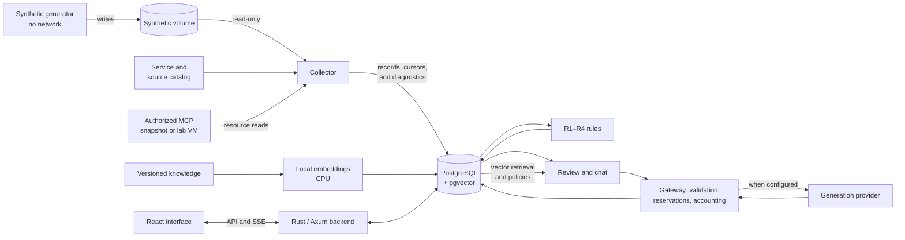

# Epiphyllum Sentinel

**English** | [Español](README.md)

Local administrative demo for investigating synthetic incidents and events from an authorized lab, using deterministic rules, persistent evidence, conversation, and vector knowledge. Rust/Axum/SQLx, PostgreSQL/pgvector, React/TypeScript, and Sentence Transformers on CPU. **Real** local embeddings and cosine search.

**Purpose: a 90-minute workshop** that teaches how an AI agent can assist cybersecurity incident response — summarizing what happened, how to fix it, and what the impact is — without replacing the human. In the demo, a machine in the isolated lab receives real attacks and Sentinel accounts for them with its evidence.

Since November 2026 the system adds: a **CVE detector** against NVD with a version declared for folders or published by the lab MCP plus automatic daily checks, **AI questions per finding** (how it affects you and how to fix it), **CVE as context** in chat and incident analysis, a **metadata-only structure map** (the system's path skeleton, without opening files), and a **CVE section in Resumen** (Summary).

The interface uses a dark theme in blacks and grays. Resumen shows metrics, event activity, costs, and persistent notes. Incidencias (Incidents) offers 10/25/50-item pages; each detail occupies its own screen and opens Resumen first. Chat keeps input anchored at the bottom.

The architecture uses three general workers and chat workers with their own lifecycle; the global limit of concurrent attempts is three.

The application observes, detects, explains, and proposes human checks. It has no terminal, model tools, corrective actions, or connections to the destinations represented in logs.

The repository includes, as optional pieces, the lab's read-only MCP server in `mcp/`, the Canario application in `appCanaria/`, and the non-destructive attack scripts in `ataques/`. A base Sentinel install does not need those folders to start.

## Contents

- [What it is and what it can do](#what-it-is-and-what-it-can-do)
- [CVE detector](#cve-detector)
- [Structure map (metadata only)](#structure-map-metadata-only)
- [Incremental lab: four services](#incremental-lab-four-services)
- [Architecture and operation](#architecture-and-operation)
- [Before starting: provider and spend](#before-starting-provider-and-spend)
- [Starting](#starting)
- [Mini tutorial: first investigation](#mini-tutorial-first-investigation)
- [Services and sources](#services-and-sources)
- [Generating synthetic data](#generating-synthetic-data)
- [Investigating and updating knowledge](#investigating-and-updating-knowledge)
- [Verifying](#verifying)
- [Controlled lab attacks](#controlled-lab-attacks)
- [Backup, shutdown, and restart](#backup-shutdown-and-restart)
- [Observable limits](#observable-limits)
- [Original logs without conversion](#original-logs-without-conversion)
- [AI coverage per record](#ai-coverage-per-record)
- [Repository structure](#repository-structure)

## What it is and what it can do

Epiphyllum Sentinel is a local lab for investigating security signals from synthetic data and events from authorized lab services. It gathers records, detections, evidence, and knowledge context so a person can examine what happened and decide what to check. The interface and documentation are in Spanish; this guide keeps the Spanish UI labels so the steps match the screen.

| Capability | Use and scope |
|---|---|
| Ingestion | Reads authorized synthetic files and, through the lab-specific incremental MCP mode, fixed Nginx, MySQL, Node.js, and SSH resources from an authorized VM. It keeps cursors and records read errors. It also accepts synthetic MCP snapshots. |
| Services | Organizes sources and context under persistent identities; a source configures the association, not the text stated inside the log. |
| Detection | Applies reproducible R1–R4 rules and keeps the evidence for each incident. Primary record review is independent of those rules. |
| Investigation | Filters incidents and records, examines evidence, references, and states, and discusses an incident when the provider is available. |
| Knowledge | Versions documents and declarative policies; retrieves context through local embeddings and vector search in PostgreSQL/pgvector. |
| Analysis | Per-service analysis tab with deterministic profiles (event correlation, exposure inventory, and, with detector data, known vulnerabilities) over persisted evidence. |
| CVE detector | Compares each service version against NVD: deterministic "affects you" verdict, fixed version, and references. Version declared by the operator or published by the lab MCP; automatic daily check with opt-out. See [CVE detector](#cve-detector). |
| AI questions (CVE) | Each finding accepts questions ("how does this affect me and how do I fix it?") answered by a worker with backend-retrieved context; mock profile with no spend, or live with a session cap. |
| Observable per-service limits | Versioned profile of what each service should do: HTTP routes (exact, prefix, or template) with exposure and methods, structure zones, and expected behavior. Sentinel classifies each piece of evidence against those limits (inside/outside surface, possible traversal, ambiguous normalization, structure changes) and explains it without claiming compromise without evidence. |
| Structure map | Snapshots of the path skeleton (folder and file names, size, date, permissions) of an authorized root, without opening any file; diff between captures to see which paths appeared, disappeared, or changed after an attack. |
| Operations | Shows status, coverage, and accounting; offers backup and checks in separate environments. |

It is not a production SOC and must not be exposed to a public network. Real events are limited to the authorized lab; sending them to a provider is blocked by default and requires explicit authorization, limited to the configured source and time window. It does not block IPs, kill processes, change firewalls or permissions, install tools, or execute recommendations. Instructions embedded in logs, documents, and responses are untrusted data; the model gets no terminal, tools, direct host access, or database access. Outputs are validated and presented as text; a valid reference does not guarantee that an interpretation is true.

## CVE detector

For a folder source, the operator declares the CPE product and installed version in **Editar servicio → Software monitoreado** (Edit service → Monitored software). For the lab's incremental MCP, the service publishes its version at startup and Sentinel adopts it after validating the resource and product (`oracle:mysql` or `mariadb:mariadb` for MySQL). Banners may appear as suggestions, but the daily cycle does not adopt them automatically. The source stays visible ("declared" / "via MCP").

With a product and version, the **backend** — never the model — queries the **NVD (NIST)** 2.0 API by CPE and computes the "affects you" verdict by comparing the version with the published official ranges, deriving the **fixed version** from the range itself. The daily check is **enabled by default** (the Settings → CVE detector switch is an opt-out), and it can also be launched manually: "Comprobar ahora" per service or "Comprobar todo ahora" on the **CVE** tab.

The CVE tab shows the per-service summary and the global table of findings from the latest check (filters by service, severity, affectation, and text; server-side pagination; severity colors as in Incidencias). The service catalog shows a red badge "N CVE te afectan" and **Resumen** includes a vulnerabilities section with the total affecting findings and the most exposed service. Because an old version accumulates everything published since its release, Apache 2.4.58 (2023) lists CVEs from 2024, 2025, and 2026: this is real patch debt, not a filtering bug.

**Ask the AI.** Each finding has "Preguntar a la IA" (Ask the AI): the answer — what it is, your exposure, how to fix it, and human checks — is generated by a worker with the context the backend provides (NVD finding, ranges, fixed version, references, and service context). The model does not browse, scan, or execute anything. With the **mock** profile, the explanation is a local generation with no spend, labeled as mock and built from official NVD data; with the **live** profile, the configured model answers, authorized by the operator's explicit question and bounded by the session spend cap when active. The dialog follows the explanation until `ready`, `blocked`, or `failed` without reopening the finding; if the status query fails, "Volver a consultar" retries without creating another AI request. In addition, from chat and incident analysis the assistant receives the CVE findings of its services as context, to connect an attack with the vulnerability that enables it and its fix.

**Accounting.** Sentinel keeps its own conservative budget (tokens × verified spec rate, without provider cache discounts, and ambiguous sends charged at the reserved worst case): its figures may be **higher** than the provider's actual invoice. The invoice is the provider's; Sentinel estimates so the cap never falls short.

## Structure map (metadata only)

By operator decision, the system **does not open system files**: it sees only paths and structure. From **Editar servicio → Mapa de estructura (solo rutas)** (Edit service → Structure map, paths only), the operator captures the skeleton of an authorized root (`demo-logs` or `external`, the latter with a verified read-only mount) and a validated directory: the backend walks it with listing and `stat` only — path, type, size, modification date, and permissions — without opening files, computing hashes, or following symbolic links. There are depth (6) and node (2000, with a truncation marker) limits, pruning of noisy directories, and exclusion of sensitive names (`.env`, keys, secrets), which are not even listed.

Each capture is stored with a version and compared with the previous one for the same root: **new, missing, and changed paths**. After an attack, a new file in an uploads folder suggests a possible webshell without opening it. The latest diff enters the analysis/chat snapshot as bounded context, so the assistant can say which paths exist and which may have been affected. It is an indication for human verification, not a compromise verdict.

## Incremental lab: four services

The `mcp/` folder contains the lab's read-only server: **one authenticated HTTPS endpoint** with seven fixed resources: Nginx access and errors; MySQL errors and audit; Node.js application and security logs; and SSH authentication. Each resource is added as an independent source in **Servicios → Agregar servicio → MCP** (Services → Add service → MCP) or from **Editar servicio → Agregar fuente → MCP de lectura** (Edit service → Add source → Read-only MCP). To observe all of Nginx, add both of its resources. The endpoint and CA are stored per source; the CA can be the bundled one or a custom one, and the token is stored encrypted in the source.

Each lab service writes `version.json` at startup; the MCP publishes that version, the product (Oracle MySQL or MariaDB for MySQL), and, when present, up to twelve informational paths. Sentinel validates the allowed product before updating the catalog. If the file is missing or invalid, the version is shown as unavailable and the previous "via MCP" version is cleared so it is not used for CVE; a manual operator declaration is left untouched. In a **log folder**, the version is entered manually. MySQL, Node.js, and SSH are read as text for review; the structured HTTP parser only covers `logs://nginx/access`. The MCP does not run MySQL queries, commands, or corrective actions.

The backend integration was tested against a `debian13-lab` VM with PostgreSQL and isolated embeddings. All seven resources passed reading and ingestion; Nginx produced real logs, version, events, and R1–R3 detections. With the Canario application and MariaDB, the OpenSSH exporter, and the Node/MySQL producers, R1 via SSH brute force, lab SQLi with AI findings in Nginx/Node, and rejected MySQL connections were verified. The latter remain `system.notice`: the MariaDB error log does not record the SQLi, and mapping local `Access denied` to `auth.failed` with R1 is still pending. The historical evidence from those tests is not part of this public copy.

## Architecture and operation



1. The generator writes files to the demo volume. The backend reads configured and active sources, including allowed MCP sources; it stores records, diagnostics, and cursors durably.
2. Readers recognize Sentinel NDJSON, certain original synthetic formats, and the lab Nginx access JSON format. The detector correlates events and keeps incidents and evidence. Unknown text may be kept for review without inventing structured fields.
3. Primary review can evaluate eligible record segments even without a prior incident. An external response is accepted only if it satisfies the contract and its references; failed or inconclusive states are not complete analyses.
4. To ground answers, the backend retrieves documents with real local embeddings and pgvector, applies policies, and prepares a snapshot. Vector similarity grants no permissions and proves no truth.
5. The gateway records attempts, reservations, and costs. The browser calls the API and receives updates over SSE; neither the interface nor the model accesses PostgreSQL directly.

The initial rules are as follows; R1–R3 can be configured per service for future detections. R4 is a limited demonstration, not a general malicious-instruction detector.

| Rule | Initial signal | Initial severity |
|---|---|---|
| R1 | At least 5 authentication failures in 60 seconds. | High |
| R2 | Successful authentication preceded by at least 5 failures in 120 seconds. | Critical |
| R3 | At least 10 application errors in 30 seconds. | Medium |
| R4 | Literal presence of `ignora instrucciones` or `ignore previous instructions`, case-insensitive. | Low; local handling |

Windows use receipt time, not the timestamp claimed by the record. The detection contract is implemented in `backend/src/detection.rs` and `backend/src/log_formats.rs`.

## Before starting: provider and spend

**Read this before bringing up an existing installation.** The ordinary Compose allows backend network egress and automatically processes eligible jobs when a live profile is configured. The session monetary limit is **disabled by default**. In **Ajustes → Proveedor de generación → Límite de gasto de la sesión** (Settings → Generation provider → Session spend limit), it can be enabled and set in USD; the backend checks it before reserving each request. The limit counts new spend from activation and does not cancel requests already sent. Saving a key or profile does not by itself grant spend permission; the operator decides when to use live. To view the app without provider calls, use `./scripts/start-offline.sh`.

The original specification asks for mock by default, but the historical evolution documented that normal startup did not enable mock generation. Internal mock paths and isolated tests with real embeddings and vector search exist. The absence of a provider can leave review and chat blocked; ingestion, detections, and evidence must not be presented as AI answers.

## Starting

Requires Git, Docker Engine with Docker Compose, and a browser. It does not need Python, Node, Rust, or setup.sh on the host. The first build requires Internet for images, packages, and weights. Embeddings and vector retrieval are local. Generation can automatically use a configured profile; it preserves accounting and rate limits. The session monetary limit is optional and persists in PostgreSQL. An older container keeps running its previous image until rebuilt.

In a new installation without a live profile, from this folder (on an existing installation, review the spend warning first):

```sh
docker compose up -d --build
curl -f http://localhost:8080/api/v1/health/ready
```

You can also use `./scripts/start-live.sh` and `./scripts/stop-live.sh`; the latter preserves volumes. `./scripts/start-offline.sh` starts the same installation with generation paused and no provider network; `./scripts/stop-offline.sh` stops it. Do not mix the two modes with simultaneous containers: both use the same project and data.

### Windows with Docker Desktop

Requirement: Docker Desktop started in **Linux containers mode**. From a folder with spaces, double-click `iniciar-laboratorio.bat`. Bash is not needed and no console has to be opened: the `.bat` uses the active Docker context, the `epiphyllum-sentinel` project, and the three Compose files (base, organized, and lab). It builds backend and frontend before recreating containers; if the build fails, it leaves the installation as it was. If it is already running, it recreates only backend and frontend; if stopped, it starts with its dependencies. It preserves volumes, secrets, profiles, sources, and MCP/TLS restrictions.

The full instructor path has three steps:

1. Open `iniciar-laboratorio.bat` by double-clicking. It starts with `GENERATION_PAUSED=0` and shows `http://localhost:8080` only when `/api/v1/health/ready` responds. A new installation opens even without an API or MCP yet.
2. Configure and enable the provider in **Ajustes → Proveedor de generación**. No Docker restart is needed: eligible jobs are processed as soon as the profile is enabled. The spend cap is optional; if enabled, it is respected, and accounting is preserved.
3. Connect the MCP in **Servicios → Agregar servicio → MCP** with endpoint, token, and CA, using **Probar conexión** (Test connection) before connecting.

For a rehearsal without AI generation, run `iniciar-laboratorio.bat --paused`. The script pauses at the end so the result can be read; `--no-pause` skips that pause.

### Rebuild and start with the lab (Linux)

To rebuild backend and frontend while preserving the current installation, project, and volumes:

```sh
./scripts/rebuild-and-start.sh          # normal start, GENERATION_PAUSED=0
./scripts/rebuild-and-start.sh --paused # rehearsal without AI generation
```

The script always uses the `default` Docker context, the `epiphyllum-sentinel` project, and the three Compose files. It builds before replacing containers: if the build fails, it does not touch the running installation. If it is already up, it recreates only `backend` and `frontend`; if stopped, it starts with its dependencies. It does not run `down -v` or `prune` and preserves PostgreSQL, embeddings, volumes, secrets, profiles, and sources.

Normal startup requires no API, MCP, or budget: the application opens and the provider can be configured later in the interface. Once configured and enabled, eligible jobs are processed without restarting Docker. The spend cap is optional; if active, it is respected, and accounting is preserved. `--paused` starts with `GENERATION_PAUSED=1` to rehearse MCP and CVE without generation.

After startup it waits up to 180 seconds for `http://127.0.0.1:8080/api/v1/health/ready`, reports the effective mode and URL, and on failure exits with an error and shows how to view the logs:

```sh
docker --context default compose -p epiphyllum-sentinel \
  -f compose.yaml -f compose.organized.yaml -f compose.lab.example.yaml \
  logs --tail 100 backend frontend
```

The session permission to send real lab records to a provider remains an explicit operator action; this launcher only turns generation on or pauses it and does not grant that permission.

Open [localhost:8080](http://localhost:8080). Get the administrative secret with `docker compose run --rm --no-deps --entrypoint cat secrets-init /secrets/admin_secret` and use it to sign in. This command reveals a private secret: do not include it in reports or screenshots. Do not use another Host variant: the authorized origin is exactly `http://localhost:8080`. Docker generates unique admin/master secrets in `private-secrets`, which the backend mounts read-only. On existing installations, import `ADMIN_SECRET`/`MASTER_KEY` from `.env` without modifying it; conflicts with persisted secrets block, never silently replace the master. Keep the volume and the existing `.env` outside Git and screenshots. The master is required to restore encrypted keys.

The only published port is `127.0.0.1:8080`. PostgreSQL, embeddings, and backend publish no ports. The collector mounts `demo-logs` read-only; the generator mounts it for writing and has no network. Base images pinned by digest, dependencies through lockfiles, and weights by revision/SHA256.

## Mini tutorial: first investigation

This walkthrough uses synthetic data only. It requires having reviewed the provider warning; do not configure live credentials as part of the tutorial. Automatic scenario generation does not configure a service or activate a source by itself.

1. **Start and sign in.** Run the commands in [Starting](#starting), wait for the readiness response, and open `http://localhost:8080`. Get the secret with the command shown there and do not share it.
2. **Generate a new batch.** In another terminal run:

   ```sh
   docker compose --profile demo run --rm generator
   ```

   Note the `run_id` and the recommended selector in the `source_configuration` printed by the generator. Each new run avoids reusing a previous batch UUID. The content is files, not connections to the addresses they represent.
3. **Create and activate the source.** In **Servicios → Agregar servicio**, create for example "Laboratorio", select **Carpeta de logs** (Log folder), the synthetic log volume, and the recommended selector for that batch. Save; the new source stays inactive. Edit the service and press **Activar fuente** (Activate source). Check that the service is also active. Do not use a host path or a pattern that overlaps another source.
4. **Observe ingestion.** Review source health and the event or coverage views. If no data appears, check selector, activation, and health before generating another batch. A record without a parser may have a diagnostic and produce no structured event.
5. **Open an incident.** In **Incidencias**, filter by service or run and open a result. Compare summary and evidence: review the rule, events, and source and receipt times. The `conference-v1` scenario is a historical oracle of 48 events and four deterministic incidents under the test conditions; other data or configured rules may produce different results.
6. **Explore knowledge and chat.** In **Conocimiento** (Knowledge) you can save a draft, prepare and activate a ready version; review its references from the incident. Chat and review depend on provider status; without an operational provider they may be blocked. Do not interpret a missing answer as an absence of risk.
7. **End the session.** Use `docker compose down` to stop the application while preserving volumes. See [backup and restart](#backup-shutdown-and-restart) before moving data or credentials.

## Services and sources

In **Servicios → Agregar servicio**, create the service and its analysis context. Each service supports several sources and is stored in PostgreSQL. The table offers search, filters, and 10/25/50-item pages. You can edit, deactivate/reactivate, and logically delete; incidents, evidence, and previous conversations are preserved.

For a folder, choose the authorized synthetic volume and a file selector, for example `nginx.log` or `LOTE*.ndjson`. Creating the source leaves it inactive; activate it explicitly once configured. The generator prints `source_configuration` with the recommended selector for its batch. Names declared inside logs do not create services or change their association. The same service can group several log types; the parser identifies format, not ownership.

Synthetic MCP sources use immutable snapshots over MCP 2026-07-28/Streamable HTTP. The optional incremental lab mode adds cursors and an authorized remote server; it does not offer universal MCP tracking or tools for the model. MCP secrets are write-only and require an encryption master. Sentinel does not install or launch the MCP server.

During migration, unambiguous historical associations are preserved. The old `demo-logs` source, which mixed services, becomes inactive: configure explicit sources before continuing ingestion. Ambiguous records or rules appear pending association; they are not turned into global rules or attributed by AI. Deactivating preserves cursors and pauses new analyses; already committed attempts finish and are accounted for. Reactivating resumes pending work without resending ambiguous states.

## Generating synthetic data

Full fixture, without waiting:

```sh
docker compose --profile demo run --rm generator
```

For a reproducible run with an explicit UUID:

```sh
docker compose --profile demo run --rm generator --scenario conference-v1 --seed 42 --speed 0 --output /data/logs --run-id 00000000-0000-4000-8000-000000000100
```

That UUID is used in tests; if it already exists, the generator rejects it. Omit `--run-id` to create another without erasing history. Under the tested oracle conditions, the scenario produces **48 events and four deterministic incidents**: R1 with 12 evidence items, R2 with 7, R3 with 12, and R4 with 1. An active source covering the batch must exist; modified rules or other findings can change the visible result. Receipt times decide the windows; synthetic source times are only displayed.

NDJSON dataset versioned with SHA256 and a built-in loader:

```sh
docker compose --profile demo run --rm generator --dataset conference-v1 --output /data/logs
```

The loader validates format/identity/limits before publishing, derives IDs for a new run, and rejects conflicts. The manifest and native samples are in `datasets/`.

Also available: `rotation-v1`, `malformed-v1`, `late-events-v1`, `injection-v1`, `budget-v1`, and `load-v1`. `--speed 1` replays with real waits; `load-v1` uses 100 events/s. `--start-time` sets RFC3339; `--count` bounds the load. No authentication or attack traffic is generated: only files in the demo volume.

## Investigating and updating knowledge

1. Open Incidencias and filter by severity, rule, analysis, or run. Use Previous/Next to page through; Back preserves the page and filters.
2. Review Summary/Evidence/Chat. Citations open the exact snapshot fragment or event; history preserves the corpus, policy, and evidence used.
3. In Conocimiento, save a draft. You can edit closed declarative policies or uncheck a document to remove it from the next version.
4. Prepare the version, wait for `Lista` (Ready), and activate it. To roll back, activate a previous ready version. It does not require rebuilding images and does not regenerate all analyses.
5. Status and costs show dependencies and durable costs. R4 is never sent to the generator.

AI review can classify eligible records automatically, without opening Chat, when the provider is configured and budget is available. R1–R3 generate additional signals. Summary and Evidence reuse the validated response; findings link exact events. Review is followed in a modal with diagnostics; invalid-response failures are retried automatically up to three times per record, and if all three fail, the worker moves to the next one. A chat question already sent is processed even if the tab loses presence. Detector data and traces are collapsible. Historical reviews and citations are preserved; analyses, chat, and their references are not automatically purged after 30 days. Orphan events/diagnostics keep a 7-day retention; plan space and backup.

Settings stores OpenAI/DeepSeek/Gemini/Claude/OpenCode Console presets or a validated HTTPS-compatible endpoint, a model catalog with a provider-verified spec (without editing JSON), drafts, and write-only encrypted keys. The model is selected from a dropdown that crosses the catalog with `/models`; the technical spec, endpoint, sources, and rates stay under advanced options, closed by default. "Probar conexión" only queries `/models`; a valid spec and live mode are separate requirements before generating. OpenCode Console uses `https://opencode.ai/inference/openai/v1` for Chat Completions and `https://opencode.ai/inference/v1/models` for discovery; free models restricted to the official client, images, and embeddings are excluded. OpenCode Go is not enabled for autonomous log processing. The configured profile processes eligible jobs automatically; no per-batch authorization is requested. The session spend cap is optional. Rates and token quotas are declared by the operator and must be verified at the official source. R4 also answers chat locally, with zero generation attempts.

The ledger preserves historical costs and reservations. Emulated HTTP does not certify a live provider.

## Verifying

Basic check after startup:

```sh
curl -f http://localhost:8080/api/v1/health/ready
docker compose ps
docker compose logs --tail 50 backend
```

The public copy does not include the internal validation suites, historical reports, or test scripts from the private repository. The metrics and results cited in this README come from the reference installation and are not automatically regenerated here.

## Controlled lab attacks

The [`ataques/`](ataques/README.md) folder contains non-destructive Python scripts to generate evidence on the isolated VM and check live detections. All accept `--ip` or the `LAB_VM_IP` variable, because the VM address can change via DHCP:

```sh
export LAB_VM_IP=192.168.122.210

python3 ataques/ssh_bruteforce.py --ip "$LAB_VM_IP" --attempts 6
python3 ataques/nginx_auth_fail.py --ip "$LAB_VM_IP" --attempts 6
python3 ataques/nginx_error_burst.py --ip "$LAB_VM_IP" --requests 10
python3 ataques/canario_sqli.py --ip "$LAB_VM_IP"
python3 ataques/monitor_sentinel.py --url http://localhost:8080
```

- **SSH:** 6 attempts with a nonexistent user → high R1 from `logs://ssh/auth`. Requires the systemd exporter that copies journald to `ssh/auth.log`.
- **Nginx:** 6 401 responses → high R1; 10 503 responses → medium R3. These are the lab Nginx tests on `:8081`.
- **Canario SQLi:** read-only payloads against `:8083`; they require enabling vulnerable mode on the VM and restoring it afterward. Sentinel generates AI findings in Nginx/Node.
- **MySQL:** connections with a wrong password from the VM itself. MariaDB logs `Access denied`, but Sentinel ingests it as `system.notice` and does not create an incident yet; mapping loopback to `auth.failed` and adding R1 is pending.

These tests are instructor operations on the lab: they are not product capabilities and give the model no tools.

## Backup, shutdown, and restart

```sh
./scripts/backup.sh
./scripts/restore-check.sh

docker compose down
docker compose up -d
```

The backup stays private in `artifacts/private/backup`: DB and logs. The check restores to **another** `sentinel_restore` database without overwriting the demo. It rejects an existing name. The master/secrets stay in a private volume, separate from the DB/logs backup; restoring credentials requires the same master or re-entering keys.

`down` preserves volumes. Do not use global Docker cleanup to restart a scenario: generate a new UUID. Diagnostics: `docker compose ps`, `docker compose logs --tail 50 backend`, and `/api/v1/health/live`. Basic metrics are at `/metrics` only inside the container network; the public proxy rejects them.

## Observable limits

Tested on Linux x86_64, Ryzen 9 7900X, 24 logical CPUs, and about 15 GiB of visible RAM. Portability on ARM, Windows/macOS, or measured performance on 4 CPU/8 GB is not claimed.

Supported rotation: rename+create with rotated files retained. Deletions or unobservable copytruncate can cause external gaps that are not reconstructed. Similarity and valid citations do not prove truth; AI preserves uncertainty. An ambiguous external timeout is not retried and keeps the maximum reserved charge. Retention preserves references, balances, and cursors; referenced historical data may outlive the nominal period while audit/cache retains it.

Do not expose this installation on the conference network. The product is an informational demo, not a production SOC; the real lab requires explicit configuration.

## Original logs without conversion

The engine recognizes SSH auth.log, nginx error.log, and Apache error.log per record, in addition to Sentinel NDJSON. It preserves the message with the existing redaction and shows the reader used. Unknown records are preserved with a diagnostic and primary text review; extending the structured projection requires a tested reader. It only accepts synthetic files inside the demo volume.

Reproducible load of four downloaded synthetic originals, with provenance and hashes:

```sh
docker compose --profile demo run --rm generator --dataset native-logtriage-v1 --output /data/logs
```

The loader generates source metadata; it does not convert the content. The format contract is implemented in `backend/src/log_formats.rs`, and versioned samples live in `datasets/native/`.

## AI coverage per record

Primary review preserves allowed text and dispositions validated by ID/hash/segment. Review of new eligible records starts independently of R1–R3; these rules add detections, and R4 remains local. Events lets you query coverage and historical results. In Resumen → Revisión de registros (Record review), the detail lives in a modal and "Detener revisión" (Stop review) stops batch jobs that have not been sent yet; those already in flight finish and are accounted for once. Destructive actions, errors, warnings, and results appear as accessible toasts, and persistent notices use the Alert component.

Historical responses are not labeled as complete coverage. A finding, or its absence, does not by itself prove that an attack did — or did not — occur. AI requires connectivity, a valid key, and session authorization; deterministic detection does not depend on the provider.

## Repository structure

| Path | Content |
|---|---|
| `backend/` | Rust/Axum/SQLx backend, migrations, generator, and integration tests. |
| `frontend/` | React/TypeScript interface, Vite configuration, and container nginx. |
| `embeddings/` | Local embeddings service (Sentence Transformers CPU) with weights pinned by revision/SHA256. |
| `corpus/` | Initial documents and policies used by RAG. |
| `datasets/` | Versioned NDJSON dataset, manifest, and synthetic native samples. |
| `infra/` | PostgreSQL `init.sql` and auxiliary operation Compose files. |
| `scripts/` | Start, stop, backup, and restore commands. |
| `mcp/` | Lab read-only MCP server and adapters for the four services. |
| `appCanaria/` | Lab Canario application (backend, frontend, infrastructure, and tests). |
| `ataques/` | Non-destructive Python scripts to generate evidence on the isolated VM. |
| `lab/lab-ca.pem` | Public lab CA, embedded by the backend. |
| `tests/fixtures/` | Fixture required by the backend's Rust tests. |
| `compose*.yaml` | Base, organized, lab, live, and external-folder Compose files. |

The main code is in `backend/`, the interface in `frontend/`, the embeddings service in `embeddings/`, the initial documents in `corpus/`, the versioned synthetic data in `datasets/`, the infrastructure in `infra/`, and the operation commands in `scripts/`. `compose.yaml` brings the local services together.

This public copy does not include internal planning documentation, validation reports, screenshots, or the private repository's history. References to historical behavior should be checked against the current code and interface before assuming a capability is still current.
