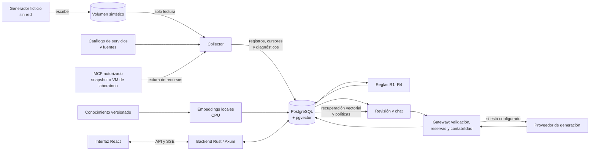

# Epiphyllum Sentinel

Demo administrativa local para investigar incidencias sintéticas y eventos de un laboratorio autorizado, con reglas deterministas, evidencia persistente, conversación y conocimiento vectorial. Rust/Axum/SQLx, PostgreSQL/pgvector, React/TypeScript y Sentence Transformers CPU. Embeddings y búsqueda coseno **reales** locales.

**Propósito: un taller de 90 minutos** que enseña cómo un agente de IA puede asistir la respuesta a incidentes de ciberseguridad — sintetizar qué pasó, cómo solucionarlo y cuál es el impacto — sin reemplazar a la persona. En la demostración, una PC del laboratorio aislado recibe ataques reales y Sentinel los cuenta con su evidencia.

Desde noviembre de 2026 el sistema suma: **detector de CVE** contra NVD con versión declarada para carpetas o publicada por el MCP del laboratorio y comprobación diaria automática, **preguntas a la IA por hallazgo** (cómo te afecta y cómo solucionarlo), **CVE como contexto** en el chat y el análisis de incidencias, **mapa de estructura de solo metadatos** (el esqueleto de rutas del sistema, sin abrir archivos) y una **sección de CVE en el Resumen**.

La interfaz usa un tema oscuro en negros y grises. Resumen muestra métricas, actividad de eventos, costos y notas persistentes. Incidencias ofrece páginas de 10/25/50 elementos; cada detalle ocupa una pantalla independiente y abre primero Resumen. El chat conserva la escritura anclada abajo.

La arquitectura usa tres trabajadores generales y trabajadores de chat con ciclo de vida propio; el límite global de intentos simultáneos es tres.

La aplicación observa, detecta, explica y propone comprobaciones humanas. No tiene terminal, herramientas del modelo, acciones correctivas ni conexiones a los destinos representados en los logs.

El repositorio incluye, como piezas opcionales, el servidor MCP de lectura del laboratorio en `mcp/`, la aplicación Canario en `appCanaria/` y los scripts no destructivos de ataque en `ataques/`. La instalación base de Sentinel no necesita esas carpetas para arrancar.

## Índice

- [Qué es y qué puede hacer](#qué-es-y-qué-puede-hacer)
- [Detector de CVE](#detector-de-cve)
- [Mapa de estructura (solo metadatos)](#mapa-de-estructura-solo-metadatos)
- [Laboratorio incremental: cuatro servicios](#laboratorio-incremental-cuatro-servicios)
- [Arquitectura y funcionamiento](#arquitectura-y-funcionamiento)
- [Antes de iniciar: proveedor y gasto](#antes-de-iniciar-proveedor-y-gasto)
- [Iniciar](#iniciar)
- [Mini tutorial: primera investigación](#mini-tutorial-primera-investigación)
- [Servicios y fuentes](#servicios-y-fuentes)
- [Generar datos ficticios](#generar-datos-ficticios)
- [Investigar y actualizar conocimiento](#investigar-y-actualizar-conocimiento)
- [Verificar](#verificar)
- [Ataques controlados del laboratorio](#ataques-controlados-del-laboratorio)
- [Backup, parada y reinicio](#backup-parada-y-reinicio)
- [Límites comprobables](#límites-comprobables)
- [Logs originales sin conversión](#logs-originales-sin-conversión)
- [Cobertura IA por registro](#cobertura-ia-por-registro)
- [Estructura del repositorio](#estructura-del-repositorio)

## Qué es y qué puede hacer

Epiphyllum Sentinel es un laboratorio local para investigar señales de seguridad a partir de datos ficticios y de eventos de servicios autorizados del laboratorio. Reúne registros, detecciones, evidencia y contexto de conocimiento para que una persona examine lo sucedido y decida qué comprobar. La interfaz y la documentación están en español.

| Capacidad | Uso y alcance |
|---|---|
| Ingesta | Lee archivos sintéticos autorizados y, mediante el modo MCP incremental específico del laboratorio, recursos fijos de Nginx, MySQL, Node.js y SSH de una VM autorizada. Conserva cursores y registra errores de lectura. También admite snapshots MCP sintéticos. |
| Servicios | Organiza fuentes y contexto bajo identidades persistentes; una fuente configura la asociación, no el texto que figura en el log. |
| Detección | Aplica reglas reproducibles R1–R4 y conserva las evidencias de cada incidencia. La revisión primaria de registros es independiente de esas reglas. |
| Investigación | Permite filtrar incidencias y registros, examinar evidencia, referencias y estados, y conversar sobre una incidencia cuando el proveedor está disponible. |
| Conocimiento | Versiona documentos y políticas declarativas; obtiene contexto mediante embeddings locales y búsqueda vectorial en PostgreSQL/pgvector. |
| Análisis | Pestaña de análisis por servicio con perfiles deterministas (correlación de eventos, inventario de exposición y, con datos del detector, vulnerabilidades conocidas) sobre la evidencia persistida. |
| Detector de CVE | Compara la versión de cada servicio contra NVD: veredicto «te afecta» determinista, versión corregida y referencias. Versión declarada por el operador o publicada por el MCP del laboratorio; comprobación diaria automática con opt-out. Detalle en [Detector de CVE](#detector-de-cve). |
| Preguntas a la IA (CVE) | Cada hallazgo admite preguntas («¿cómo me afecta y cómo lo soluciono?») que responde un worker con el contexto que recupera el backend; perfil mock sin gasto o live con tope de sesión. |
| Límites observables por servicio | Perfil versionado de lo que cada servicio debería hacer: rutas HTTP (exactas, prefijo o plantilla) con exposición y métodos, zonas de estructura y comportamiento esperado. Sentinel clasifica cada evidencia contra esos límites (dentro/fuera de superficie, posible traversal, normalización ambigua, cambios de estructura) y lo explica sin afirmar compromiso sin evidencia. |
| Mapa de estructura | Snapshots del esqueleto de rutas (carpetas y nombres, tamaño, fecha, permisos) de una raíz autorizada, sin abrir ningún archivo; diff entre capturas para ver qué rutas aparecieron, desaparecieron o cambiaron tras un ataque. |
| Operación | Muestra estado, cobertura y contabilidad; ofrece respaldo y comprobaciones en entornos separados. |

No es un SOC de producción ni se debe exponer a una red pública. Los eventos reales se limitan al laboratorio autorizado; su envío a un proveedor está bloqueado por defecto y requiere una autorización explícita, limitada a la fuente y al plazo configurados. No bloquea IP, termina procesos, cambia firewalls o permisos, instala herramientas ni ejecuta recomendaciones. Las instrucciones incorporadas en registros, documentos y respuestas son datos no confiables; el modelo no recibe terminal, herramientas, acceso directo al host ni a la base de datos. Las salidas se validan y presentan como texto; una referencia válida no garantiza que una interpretación sea cierta.

## Detector de CVE

Para una fuente de carpeta, el operador declara el producto CPE y la versión instalada en **Editar servicio → Software monitoreado**. Para el MCP incremental del laboratorio, el servicio publica su versión al arrancar y Sentinel la adopta tras validar el recurso y el producto (`oracle:mysql` o `mariadb:mariadb` en MySQL). Los banners pueden aparecer como sugerencias, pero el ciclo diario no los adopta automáticamente. La procedencia queda visible («declarado» / «vía MCP»).

Con producto y versión, el **backend** — nunca el modelo — consulta la API 2.0 de **NVD (NIST)** por CPE y calcula el veredicto «te afecta» comparando la versión con los rangos oficiales publicados, derivando la **versión corregida** del propio rango. La comprobación diaria está **activada por defecto** (el interruptor de Ajustes → Detector de CVE es un opt-out), y también se puede lanzar a mano: «Comprobar ahora» por servicio o «Comprobar todo ahora» en la pestaña **CVE**.

La pestaña CVE muestra el resumen por servicio y la tabla global de hallazgos de la última comprobación (filtros por servicio, severidad, afectación y texto; paginación en servidor; colores de severidad como en Incidencias). El catálogo de servicios muestra una insignia roja «N CVE te afectan» y el **Resumen** incluye una sección de vulnerabilidades con el total de afectantes y el servicio más expuesto. Como una versión vieja acumula todo lo publicado desde su época, un Apache 2.4.58 (2023) lista CVE de 2024, 2025 y 2026: es deuda de parches real, no un error de filtrado.

**Preguntar a la IA.** Cada hallazgo tiene «Preguntar a la IA»: la respuesta — qué es, tu exposición, cómo solucionarlo y verificaciones humanas — la genera un worker con el contexto que el backend le entrega (hallazgo de NVD, rangos, versión corregida, referencias y el contexto del servicio). El modelo no navega, no escanea y no ejecuta nada. Con el perfil **mock** la explicación es una generación local sin gasto, etiquetada como mock y construida con los datos oficiales de NVD; con perfil **live** responde el modelo configurado, autorizado por la pregunta explícita del operador y acotado por el tope de gasto de sesión cuando está activo. El diálogo sigue la explicación hasta `ready`, `blocked` o `failed` sin reabrir el hallazgo; si falla la consulta de estado, «Volver a consultar» reintenta sin crear otra solicitud de IA. Además, desde el chat y el análisis de una incidencia el asistente recibe los hallazgos CVE de sus servicios como contexto, para conectar un ataque con la vulnerabilidad que lo habilita y su corrección.

**Contabilidad.** Sentinel lleva un presupuesto conservador propio (tokens × tarifa verificada del spec, sin descuento por caché del proveedor y con los envíos ambiguos cobrados al peor caso reservado): sus cifras pueden ser **mayores** que la factura real del proveedor. La factura es la del proveedor; Sentinel estima para que el tope nunca se quede corto.

## Mapa de estructura (solo metadatos)

Por decisión del operador, el sistema **no abre archivos del sistema**: ve solo rutas y estructura. Desde **Editar servicio → Mapa de estructura (solo rutas)** el operador captura el esqueleto de una raíz autorizada (`demo-logs` o `external`, esta última con el montaje de solo lectura verificado) y un directorio validado: el backend recorre con listado y `stat` únicamente — ruta, tipo, tamaño, fecha de modificación y permisos — sin abrir archivos, sin calcular hashes y sin seguir enlaces simbólicos. Hay límites de profundidad (6) y de nodos (2000, con marca de truncamiento), poda de directorios ruidosos y exclusión de nombres sensibles (`.env`, claves, secretos), que ni siquiera se listan.

Cada captura se guarda versionada y se compara con la anterior de la misma raíz: **rutas nuevas, desaparecidas y cambiadas**. Tras un ataque, un archivo nuevo en una carpeta de subidas sugiere una posible webshell sin necesidad de abrirla. El último diff entra como contexto acotado en el snapshot de análisis/chat, para que el asistente pueda decir qué rutas existen y cuáles pudieron ser afectadas. Es un indicio para verificación humana, no un veredicto de compromiso.

## Laboratorio incremental: cuatro servicios

La carpeta `mcp/` contiene el servidor de lectura del laboratorio: **un endpoint HTTPS autenticado** con siete recursos fijos: accesos y errores de Nginx; errores y auditoría de MySQL; logs de aplicación y seguridad de Node.js; y autenticación SSH. Cada recurso se agrega como fuente independiente en **Servicios → Agregar servicio → MCP** o desde **Editar servicio → Agregar fuente → MCP de lectura**. Para observar Nginx completo, agregá sus dos recursos. El endpoint y la CA se guardan por fuente; la CA puede ser la del paquete o una personalizada, y el token se guarda cifrado en la fuente.

Cada servicio del laboratorio escribe `version.json` al arrancar; el MCP publica esa versión, el producto (Oracle MySQL o MariaDB en el caso de MySQL) y, si las hay, hasta doce rutas informativas. Sentinel valida el producto permitido antes de actualizar el catálogo. Si el archivo falta o es inválido, la versión figura como no disponible y se limpia la versión anterior de origen «vía MCP» para no usarla en CVE; una declaración manual del operador no se toca. En una **carpeta de logs** se introduce la versión manualmente. MySQL, Node.js y SSH se leen como texto para revisión; el parser HTTP estructurado solo cubre `logs://nginx/access`. El MCP no ejecuta consultas MySQL, comandos ni acciones correctivas.

La integración del backend se probó contra una VM `debian13-lab` con PostgreSQL y embeddings aislados. Los siete recursos pasaron lectura e ingesta; Nginx produjo logs reales, versión, eventos y detecciones R1–R3. Con la aplicación Canario y MariaDB, el exportador de OpenSSH y los productores de Node/MySQL se verificaron R1 por fuerza bruta SSH, SQLi de laboratorio con hallazgos AI en Nginx/Node y conexiones MySQL rechazadas. Estas últimas quedan como `system.notice`: el error log de MariaDB no registra la SQLi y todavía falta mapear `Access denied` local a `auth.failed` con R1. La evidencia histórica de esas pruebas no forma parte de esta copia pública.

## Arquitectura y funcionamiento



1. El generador escribe archivos en el volumen de demostración. El backend lee fuentes configuradas y activas, incluidas las fuentes MCP permitidas; guarda los registros, diagnósticos y cursores de forma durable.
2. Los lectores reconocen NDJSON Sentinel, ciertos formatos originales sintéticos y el formato JSON de acceso del Nginx de laboratorio. El detector correlaciona eventos y conserva incidentes y evidencia. El texto desconocido puede conservarse para revisión sin inventar campos estructurados.
3. La revisión primaria puede evaluar segmentos de registros elegibles aun sin incidencia previa. Una respuesta externa se acepta solo si satisface el contrato y sus referencias; los estados fallidos o no concluyentes no son análisis completos.
4. Para fundamentar respuestas, el backend recupera documentos con embeddings locales reales y pgvector, aplica las políticas y prepara un snapshot. La similitud vectorial no concede permisos ni demuestra veracidad.
5. El gateway registra intentos, reservas y costos. El navegador consulta la API y recibe actualizaciones por SSE; ni la interfaz ni el modelo acceden directamente a PostgreSQL.

Las reglas iniciales son las siguientes; las reglas R1–R3 pueden configurarse por servicio para detecciones futuras. R4 es una demostración limitada, no un detector general de instrucciones maliciosas.

| Regla | Señal inicial | Severidad inicial |
|---|---|---|
| R1 | Al menos 5 fallos de autenticación en 60 segundos. | Alta |
| R2 | Autenticación exitosa precedida por al menos 5 fallos en 120 segundos. | Crítica |
| R3 | Al menos 10 errores de aplicación en 30 segundos. | Media |
| R4 | Presencia literal de `ignora instrucciones` o `ignore previous instructions`, sin distinguir mayúsculas. | Baja; tratamiento local |

Las ventanas usan el tiempo de recepción, no el timestamp que afirma el registro. El contrato de detección está implementado en `backend/src/detection.rs` y `backend/src/log_formats.rs`.

## Antes de iniciar: proveedor y gasto

**Lea esto antes de levantar una instalación existente.** El Compose ordinario permite salida de red del backend y procesa automáticamente trabajos elegibles si existe un perfil live configurado. El límite monetario de sesión está **desactivado por defecto**. En **Ajustes → Proveedor de generación → Límite de gasto de la sesión** se puede activar y fijar un monto en USD; el backend lo comprueba antes de reservar cada solicitud. El límite cuenta gasto nuevo desde su activación y no cancela solicitudes ya enviadas. Guardar una clave o perfil no constituye por sí solo permiso de gasto; el operador decide cuándo usar live. Para ver la app sin llamadas al proveedor, use `./scripts/start-offline.sh`.

La especificación original pide mock por defecto, pero la evolución histórica documentó que el arranque normal no habilitó generación mock. Existen rutas mock internas y pruebas aisladas con embeddings y búsqueda vectorial reales. La falta de proveedor puede dejar revisión y chat bloqueados; ingesta, detecciones y evidencia no deben presentarse como respuestas de IA.

## Iniciar

Requiere Git, Docker Engine con Docker Compose y navegador. No necesita Python, Node, Rust ni setup.sh en el host. El primer build requiere Internet para imágenes, paquetes y pesos. Los embeddings y la recuperación vectorial son locales. La generación puede utilizar automáticamente un perfil configurado; conserva contabilidad y límites de frecuencia. El límite monetario de sesión es opcional y persiste en PostgreSQL. Un contenedor anterior sigue ejecutando su imagen anterior hasta reconstruirlo.

En una instalación nueva y sin perfil live, desde esta carpeta (en una instalación existente revise antes la advertencia de gasto):

```sh
docker compose up -d --build
curl -f http://localhost:8080/api/v1/health/ready
```

También puede usar `./scripts/start-live.sh` y `./scripts/stop-live.sh`; el segundo conserva los volúmenes. `./scripts/start-offline.sh` inicia la misma instalación con generación pausada y sin red del proveedor; `./scripts/stop-offline.sh` la detiene. No mezcle los dos modos con contenedores simultáneos: ambos usan el mismo proyecto y datos.

### Windows con Docker Desktop

Requisito: Docker Desktop iniciado en **modo contenedores Linux**. Desde una carpeta con espacios, doble clic en `iniciar-laboratorio.bat`. No hace falta Bash ni abrir una consola: el `.bat` usa el contexto Docker activo, el proyecto `epiphyllum-sentinel` y los tres Compose (base, organizado y laboratorio). Compila backend y frontend antes de recrear contenedores; si el build falla, deja la instalación como estaba. Si ya está levantada, recrea solo backend y frontend; si está detenida, arranca con sus dependencias. Conserva volúmenes, secretos, perfiles, fuentes y restricciones MCP/TLS.

El recorrido completo para el profesor son tres pasos:

1. Abrir `iniciar-laboratorio.bat` con doble clic. Arranca con `GENERATION_PAUSED=0` y muestra `http://localhost:8080` solo cuando `/api/v1/health/ready` responde. Una instalación nueva abre aunque todavía no tenga API ni MCP.
2. Configurar y habilitar el proveedor en **Ajustes → Proveedor de generación**. No hace falta reiniciar Docker: los trabajos elegibles se procesan en cuanto el perfil queda habilitado. El tope de gasto es opcional; si lo activás, se respeta, y la contabilidad se conserva.
3. Conectar el MCP en **Servicios → Agregar servicio → MCP** con endpoint, token y CA, usando **Probar conexión** antes de conectar.

Para un ensayo sin generación de IA, ejecutar `iniciar-laboratorio.bat --paused`. El script pausa al final para poder leer el resultado; `--no-pause` evita esa pausa.

### Recompilar y arrancar con el laboratorio (Linux)

Para recompilar backend y frontend y conservar la instalación, proyecto y volúmenes actuales:

```sh
./scripts/rebuild-and-start.sh          # arranque normal, GENERATION_PAUSED=0
./scripts/rebuild-and-start.sh --paused # ensayo sin generación de IA
```

El script usa siempre el contexto Docker `default`, el proyecto `epiphyllum-sentinel` y los tres Compose. Compila antes de sustituir contenedores: si el build falla, no toca la instalación en ejecución. Si ya está levantada, recrea solo `backend` y `frontend`; si está detenida, arranca con sus dependencias. No ejecuta `down -v` ni `prune` y conserva PostgreSQL, embeddings, volúmenes, secretos, perfiles y fuentes.

El arranque normal no exige API, MCP ni presupuesto: la aplicación abre y podés configurar el proveedor después en la interfaz. Cuando lo configures y habilites, los trabajos elegibles se procesan sin reiniciar Docker. El tope de gasto es opcional; si está activo, se respeta, y la contabilidad se conserva. `--paused` arranca con `GENERATION_PAUSED=1` para ensayar MCP y CVE sin generación.

Después del arranque espera hasta 180 segundos a `http://127.0.0.1:8080/api/v1/health/ready`, informa el modo efectivo y la URL, y si falla termina con error e indica cómo ver los logs:

```sh
docker --context default compose -p epiphyllum-sentinel \
  -f compose.yaml -f compose.organized.yaml -f compose.lab.example.yaml \
  logs --tail 100 backend frontend
```

El permiso de sesión para enviar registros reales del laboratorio a un proveedor sigue siendo una acción explícita del operador; este lanzador solo enciende o pausa la generación y no concede ese permiso.

Abra [localhost:8080](http://localhost:8080). Obtenga el secreto administrativo con `docker compose run --rm --no-deps --entrypoint cat secrets-init /secrets/admin_secret` y úselo para iniciar sesión. Este comando revela un secreto privado: no lo incluya en reportes/capturas. No use otra variante de Host: el origen autorizado es exactamente `http://localhost:8080`. Docker genera admin/maestro únicos en `private-secrets`, que el backend monta read-only. En instalaciones existentes importa `ADMIN_SECRET`/`MASTER_KEY` de `.env` sin modificarlo; conflictos con secretos persistidos bloquean, nunca reemplazan el maestro silenciosamente. Conserve el volumen y el `.env` existente fuera de Git/capturas. El maestro es necesario para restaurar claves cifradas.

El único puerto publicado es `127.0.0.1:8080`. PostgreSQL, embeddings y backend no publican puertos. El collector monta `demo-logs` como solo lectura; el generador lo monta para escritura y no tiene red. Imágenes base fijadas por digest, dependencias mediante lockfiles y pesos por revisión/SHA256.

## Mini tutorial: primera investigación

Este recorrido usa exclusivamente datos sintéticos. Requiere haber revisado la advertencia de proveedor; no configure credenciales live como parte del tutorial. La generación automática del escenario no configura por sí sola un servicio ni activa una fuente.

1. **Inicie e identifíquese.** Ejecute los comandos de [inicio](#iniciar), espere la respuesta de readiness y abra `http://localhost:8080`. Obtenga el secreto con el comando indicado allí y no lo comparta.
2. **Genere un lote nuevo.** En otra terminal ejecute:

   ```sh
   docker compose --profile demo run --rm generator
   ```

   Anote el `run_id` y el selector recomendado en `source_configuration` que imprime el generador. Cada ejecución nueva evita reutilizar el UUID de un lote anterior. El contenido son archivos, no conexiones a las direcciones que representan.
3. **Cree y active la fuente.** En **Servicios → Agregar servicio**, cree por ejemplo «Laboratorio», seleccione **Carpeta de logs**, el volumen de logs sintéticos y el selector recomendado para ese lote. Guarde; la fuente nueva queda inactiva. Edite el servicio y pulse **Activar fuente**. Compruebe que también esté activo el servicio. No use una ruta del host ni un patrón que se solape con otra fuente.
4. **Observe la ingesta.** Revise la salud de la fuente y las vistas de eventos o cobertura. Si no aparecen datos, compruebe selector, activación y salud antes de generar otro lote. Un registro sin parser puede tener diagnóstico y no producir un evento estructurado.
5. **Abra una incidencia.** En **Incidencias**, filtre por servicio o run y abra un resultado. Compare resumen y evidencia: revise la regla, los eventos y las horas de origen y recepción. El escenario `conference-v1` es un oráculo histórico de 48 eventos y cuatro incidencias deterministas bajo las condiciones de prueba; otros datos o reglas configuradas pueden producir resultados diferentes.
6. **Explore conocimiento y chat.** En **Conocimiento** puede guardar un borrador, preparar y activar una versión lista; consulte sus referencias desde la incidencia. El chat y la revisión dependen del estado del proveedor; sin uno operativo pueden quedar bloqueados. No interprete una ausencia de respuesta como ausencia de riesgos.
7. **Termine la sesión.** Use `docker compose down` para detener la aplicación conservando volúmenes. Consulte [backup y reinicio](#backup-parada-y-reinicio) antes de mover datos o credenciales.

## Servicios y fuentes

En **Servicios → Agregar servicio**, creá el servicio y su contexto de análisis. Cada servicio admite varias fuentes y se guarda en PostgreSQL. La tabla ofrece búsqueda, filtros y páginas 10/25/50. Podés editar, desactivar/reactivar y eliminar lógicamente; incidencias, evidencia y conversaciones anteriores se conservan.

Para una carpeta elegí el volumen sintético autorizado y un selector de archivo, por ejemplo `nginx.log` o `LOTE*.ndjson`. Crear la fuente la deja inactiva; activala explícitamente cuando esté configurada. El generador imprime `source_configuration` con el selector recomendado para su lote. Los nombres declarados dentro de los logs no crean servicios ni cambian su asociación. Un mismo servicio puede agrupar varios tipos de log; el parser identifica formato, no pertenencia.

Las fuentes MCP sintéticas usan snapshots inmutables mediante MCP 2026-07-28/Streamable HTTP. El modo opcional de laboratorio incremental incorpora cursores y un servidor remoto autorizado; no ofrece seguimiento MCP universal ni herramientas al modelo. Los secretos MCP son write-only y requieren maestro de cifrado. Sentinel no instala ni lanza el servidor MCP.

Al migrar, las asociaciones históricas inequívocas se conservan. La fuente antigua `demo-logs`, que mezclaba servicios, queda inactiva: configurá fuentes explícitas antes de continuar ingesta. Los registros o reglas ambiguos aparecen pendientes de asociación; no se convierten en reglas globales ni se atribuyen por IA. Desactivar conserva cursores y pausa nuevos análisis; los intentos ya comprometidos terminan y se contabilizan. Reactivar retoma pendientes sin reenviar estados ambiguos.

## Generar datos ficticios

Fixture completo, sin esperar:

```sh
docker compose --profile demo run --rm generator
```

Para un run reproducible con UUID explícito:

```sh
docker compose --profile demo run --rm generator --scenario conference-v1 --seed 42 --speed 0 --output /data/logs --run-id 00000000-0000-4000-8000-000000000100
```

Ese UUID se usa en las pruebas; si ya existe, el generador lo rechaza. Omita `--run-id` para crear otro sin borrar historial. En las condiciones del oráculo probado, el escenario produce **48 eventos y cuatro incidencias deterministas**: R1 con 12 evidencias, R2 con 7, R3 con 12 y R4 con 1. Debe existir una fuente activa que abarque el lote; reglas modificadas u otros hallazgos pueden cambiar el resultado visible. Las horas de recepción deciden las ventanas; las horas ficticias de origen solo se muestran.

Dataset NDJSON versionado con SHA256 y loader incorporado:

```sh
docker compose --profile demo run --rm generator --dataset conference-v1 --output /data/logs
```

El loader valida formato/identidad/límites antes de publicar, deriva IDs de un run nuevo y rechaza conflictos. El manifest y las muestras nativas están en `datasets/`.

También están disponibles `rotation-v1`, `malformed-v1`, `late-events-v1`, `injection-v1`, `budget-v1` y `load-v1`. `--speed 1` reproduce con esperas reales; `load-v1` usa 100 eventos/s. `--start-time` fija RFC3339; `--count` acota la carga. No se genera tráfico de autenticación ni de ataque: solo archivos en el volumen de demo.

## Investigar y actualizar conocimiento

1. Abra Incidencias y filtre por severidad, regla, análisis o run. Use Anterior/Siguiente para recorrer páginas; Volver conserva su página y filtros.
2. Revise Resumen/Evidencia/Chat. Las citas abren el fragmento o evento exacto del snapshot; el historial conserva corpus, política y evidencia usados.
3. En Conocimiento, guarde un borrador. Puede editar políticas declarativas cerradas o desmarcar un documento para retirarlo de la próxima versión.
4. Prepare la versión, espere `Lista` y actívela. Para revertir, active una versión lista anterior. No requiere reconstruir imágenes y no vuelve a generar todos los análisis.
5. Estado y costos muestra dependencias y costos durables. R4 nunca se envía al generador.

La revisión IA puede clasificar registros elegibles automáticamente, sin abrir Chat, cuando el proveedor está configurado y hay presupuesto disponible. R1–R3 generan señales adicionales. Resumen y Evidencia reutilizan la respuesta validada; los hallazgos enlazan eventos exactos. La revisión se sigue en un modal con diagnóstico; los fallos por respuesta inválida se reintentan automáticamente hasta tres veces por registro y, si los tres fallan, el worker pasa al siguiente. Una pregunta de chat ya enviada se procesa aunque la pestaña pierda presencia. Datos del detector y trazas son desplegables. Se conservan revisiones y citas históricas; análisis, chat y sus referencias no se purgan automáticamente a 30 días. Eventos huérfanos/diagnósticos mantienen retención de 7 días; planifique espacio y backup.

Ajustes guarda presets OpenAI/DeepSeek/Gemini/Claude o compatible HTTPS validado, un catálogo de modelos con ficha verificada por proveedor (sin editar JSON), borradores y claves write-only cifradas. El modelo se elige en un desplegable que cruza el catálogo con `/models`; la ficha técnica, el endpoint, las fuentes y las tarifas quedan en opciones avanzadas, cerradas por defecto. «Probar conexión» solo consulta `/models`; una ficha válida y el modo live son requisitos separados antes de generar. El perfil configurado procesa automáticamente los trabajos elegibles; no se solicita autorización por lote. El tope de gasto de la sesión es opcional. Las tarifas y cotas de tokens son declaradas por el operador y deben verificarse en la fuente oficial. R4 también responde al chat localmente, con cero intentos de generación.

El ledger conserva costos y reservas históricos. HTTP emulado no acredita proveedor live.

## Verificar

Comprobación básica después de arrancar:

```sh
curl -f http://localhost:8080/api/v1/health/ready
docker compose ps
docker compose logs --tail 50 backend
```

La copia pública no incluye las suites internas de validación, los reportes históricos ni los scripts de prueba del repositorio privado. Las métricas y resultados citados en este README provienen de la instalación de referencia y no se regeneran automáticamente aquí.

## Ataques controlados del laboratorio

La carpeta [`ataques/`](ataques/README.md) reúne scripts Python no destructivos para generar evidencia en la VM aislada y comprobar detecciones en vivo. Todos aceptan `--ip` o la variable `LAB_VM_IP`, porque la dirección de la VM puede cambiar por DHCP:

```sh
export LAB_VM_IP=192.168.122.210

python3 ataques/ssh_bruteforce.py --ip "$LAB_VM_IP" --attempts 6
python3 ataques/nginx_auth_fail.py --ip "$LAB_VM_IP" --attempts 6
python3 ataques/nginx_error_burst.py --ip "$LAB_VM_IP" --requests 10
python3 ataques/canario_sqli.py --ip "$LAB_VM_IP"
python3 ataques/monitor_sentinel.py --url http://localhost:8080
```

- **SSH:** 6 intentos con usuario inexistente → R1 alta desde `logs://ssh/auth`. Requiere el exportador systemd que copia journald a `ssh/auth.log`.
- **Nginx:** 6 respuestas 401 → R1 alta; 10 respuestas 503 → R3 media. Son las pruebas del Nginx de laboratorio en `:8081`.
- **SQLi Canario:** payloads de solo lectura contra `:8083`; requieren habilitar el modo vulnerable en la VM y restaurarlo al terminar. Sentinel genera hallazgos AI en Nginx/Node.
- **MySQL:** conexiones con contraseña incorrecta desde la propia VM. MariaDB registra `Access denied`, pero Sentinel lo ingiere como `system.notice` y todavía no crea incidencia; falta mapear loopback a `auth.failed` y añadir R1.

Estas pruebas son operaciones del instructor sobre el laboratorio: no son capacidades del producto ni dan herramientas al modelo.

## Backup, parada y reinicio

```sh
./scripts/backup.sh
./scripts/restore-check.sh

docker compose down
docker compose up -d
```

El backup queda privado en `artifacts/private/backup`: DB y logs. La comprobación restaura a **otra** base `sentinel_restore`, sin sobrescribir la demo. Rechaza un nombre ya existente. El maestro/secretos se conservan en volumen privado, aparte del backup DB/logs; un restore de credenciales exige el mismo maestro o reingresar claves.

`down` conserva los volúmenes. No use borrado global de Docker para reiniciar un escenario: genere un UUID nuevo. Diagnóstico: `docker compose ps`, `docker compose logs --tail 50 backend` y `/api/v1/health/live`. Las métricas básicas están en `/metrics` solo dentro de la red de contenedores; el proxy público las rechaza.

## Límites comprobables

Probado en Linux x86_64, Ryzen 9 7900X, 24 CPU lógicas y unos 15 GiB de RAM visibles. No se anuncia portabilidad ensayada en ARM, Windows/macOS ni rendimiento medido en 4 CPU/8 GB.

Rotación soportada: rename+create con rotados retenidos. Borrados o copytruncate no observable pueden causar gaps externos que no se reconstruyen. Similitud y citas válidas no prueban verdad; la IA conserva incertidumbre. Un timeout externo ambiguo no se reenvía y conserva el cargo máximo reservado. La retención preserva referencias, saldos y cursores; los datos históricos referenciados pueden sobrevivir al plazo nominal mientras exista auditoría/caché que los retenga.

No exponer esta instalación en la red de la conferencia. El producto es una demo informativa, no un SOC productivo; el laboratorio real requiere configuración explícita.

## Logs originales sin conversión

El motor reconoce por registro SSH auth.log, nginx error.log y Apache error.log, además de Sentinel NDJSON. Conserva el mensaje con la redacción existente y muestra el lector utilizado. Los registros desconocidos se conservan con diagnóstico y revisión primaria de texto; ampliar la proyección estructurada requiere un lector probado. Solo admite archivos sintéticos dentro del volumen de demo.

Carga reproducible de cuatro originales sintéticos descargados, con procedencia y hashes:

```sh
docker compose --profile demo run --rm generator --dataset native-logtriage-v1 --output /data/logs
```

El cargador genera los metadatos de fuente; no convierte el contenido. El contrato de formatos está implementado en `backend/src/log_formats.rs` y las muestras versionadas viven en `datasets/native/`.

## Cobertura IA por registro

La revisión primaria conserva texto permitido y disposiciones validadas por ID/hash/segmento. La revisión de nuevos registros elegibles se inicia independientemente de R1–R3; estas reglas aportan detecciones adicionales y R4 sigue local. Eventos permite consultar la cobertura y los resultados históricos. En Resumen → Revisión de registros, el detalle vive en un modal y «Detener revisión» detiene los trabajos del lote que todavía no se enviaron; los que ya están en vuelo terminan y se contabilizan una vez. Las acciones destructivas, los errores, las advertencias y los resultados aparecen como toasts accesibles, y los avisos persistentes usan el componente Alert.

Las respuestas históricas no se etiquetan como cobertura completa. Un hallazgo o su ausencia no demuestra por sí solo que haya ocurrido —o que no haya ocurrido— un ataque. La IA requiere conectividad, clave válida y autorización de la sesión; la detección determinista no depende del proveedor.

## Estructura del repositorio

| Ruta | Contenido |
|---|---|
| `backend/` | Backend Rust/Axum/SQLx, migraciones, generador y pruebas de integración. |
| `frontend/` | Interfaz React/TypeScript, configuración de Vite y nginx del contenedor. |
| `embeddings/` | Servicio local de embeddings (Sentence Transformers CPU) con pesos fijados por revisión/SHA256. |
| `corpus/` | Documentos y políticas iniciales usados por el RAG. |
| `datasets/` | Dataset NDJSON versionado, manifest y muestras nativas sintéticas. |
| `infra/` | `init.sql` de PostgreSQL y Compose auxiliares de operación. |
| `scripts/` | Comandos de arranque, parada, respaldo y restauración. |
| `mcp/` | Servidor MCP de lectura del laboratorio y adaptadores de los cuatro servicios. |
| `appCanaria/` | Aplicación Canario del laboratorio (backend, frontend, infraestructura y pruebas). |
| `ataques/` | Scripts Python no destructivos para generar evidencia en la VM aislada. |
| `lab/lab-ca.pem` | CA pública del laboratorio, embebida por el backend. |
| `tests/fixtures/` | Fixture requerido por las pruebas Rust del backend. |
| `compose*.yaml` | Compose base, organizado, de laboratorio, live y de carpeta externa. |

El código principal está en `backend/`, la interfaz en `frontend/`, el servicio de embeddings en `embeddings/`, los documentos iniciales en `corpus/`, los datos ficticios versionados en `datasets/`, la infraestructura en `infra/` y los comandos de operación en `scripts/`. `compose.yaml` reúne los servicios locales.

Esta copia pública no incluye la documentación interna de planificación, los reportes de validación, las capturas ni el historial del repositorio privado. Las referencias a comportamientos históricos deben contrastarse con el código y la interfaz actuales antes de asumir que una capacidad sigue vigente.
